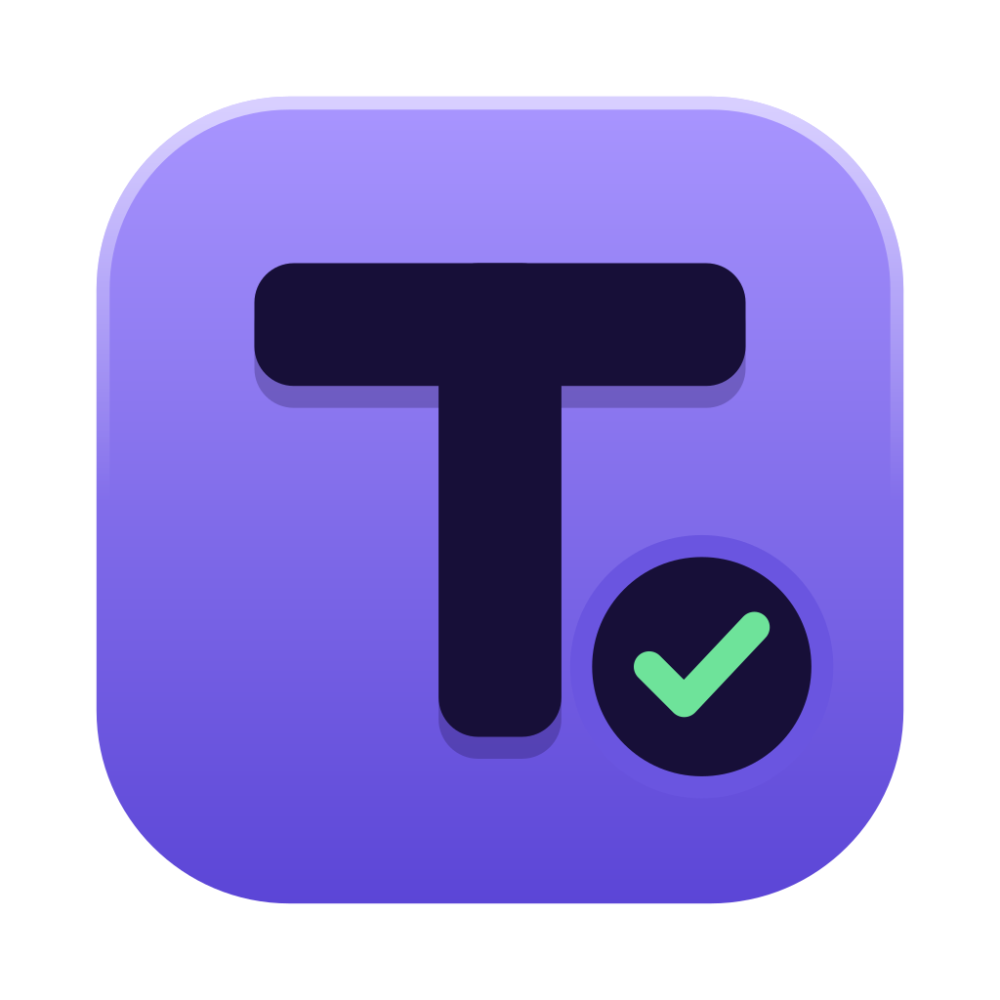

<div align="center">



# Taskminal

**일감 하나에, 터미널과 AI 대화를 함께.**

여러 프로젝트를 오가도 하던 자리를 잃지 않는 데스크톱 작업 공간입니다.

[홈페이지](https://taskminal.petercoders.com) · [내려받기](https://taskminal.petercoders.com/#downloads) · [Docs](https://taskminal.petercoders.com/docs/) · [릴리스 노트](https://github.com/petercorders/taskminal/releases) · [English docs](https://taskminal.petercoders.com/en/docs/)


</div>

---

## 하던 일을 한곳에

| 원하는 것 | Taskminal에서 |
|---|---|
| 프로젝트마다 작업 공간 유지 | 일감별 폴더·탭·분할, 상태와 메모, 보관함 |
| AI와 터미널을 함께 사용 | Claude Code·Codex 대화, 승인·질문 카드, 셸 바로 꺼내기 |
| 앱을 다시 열고 이어서 작업 | 앱 밖 셸 지킴이, 실행 중인 셸 재연결, 출력 복원 |
| 작업 맥락을 빠르게 확인 | 대화 기록 검색, 파일·Markdown·그림·PDF 미리보기, 내장 브라우저 |
| 변경을 확인하고 마무리 | Git diff·커밋, GitHub PR·push, worktree 관리 |
| 반복 작업을 정리 | 빠른 명령, 에이전트 작업 흐름, 예약과 결과함 |

Claude Code·Codex는 사용자가 설치하고 로그인한 CLI를 사용합니다. Taskminal 구독은 없으며, 각 AI 서비스의 이용 요금과 권한은 해당 계정에 따릅니다.

## 내려받기

**[OS별 다운로드 열기 →](https://taskminal.petercoders.com/#downloads)**

홈페이지는 공개 릴리스에 실제로 있는 설치 파일만 연결합니다. 아직 준비되지 않은 플랫폼은 준비 중으로 표시됩니다.

| 플랫폼 | 설치 파일 | 알아둘 점 |
|---|---|---|
| macOS · Apple Silicon | `.dmg` | M1 이후 Mac용. 공개 Mac 빌드는 Developer ID 서명·Apple 공증 후 제공 |
| macOS · Intel | `.dmg` | Intel Mac용. Apple Silicon 파일과 구분해서 선택 |
| Windows · x64 (베타) | `.exe` | 첫 지원 버전. 코드 서명 인증서가 없어 설치 시 보안 확인이 표시될 수 있음 |
| Linux · x64 (베타) | `.AppImage` / `.deb` | 배포판에 따라 추가 시스템 패키지가 필요할 수 있음 |

Windows의 포트 자동 감지, 엄격한 실행 폴더 확인이 필요한 worktree 정리, 추가 계정의 TUI 전환은 아직 지원하지 않습니다. 상세 설치 방법과 제약은 [Docs](https://taskminal.petercoders.com/docs/#install)에서 확인하세요.

## 처음 3분

1. **설치** — 컴퓨터의 OS·칩에 맞는 파일을 내려받고 앱을 엽니다.
2. **일감 만들기** — 새 일감에서 프로젝트 폴더를 고르고 Claude·Codex·터미널 중 시작 화면을 선택합니다.
3. **함께 작업하기** — 대화로 요청하고, `⌘J`로 셸을 꺼내 확인합니다. Windows·Linux의 주요 앱 단축키는 `Ctrl`을 사용합니다.
4. **이어서 하기** — 일감을 옮겼다가 돌아오거나 앱을 다시 열면 같은 작업 공간에서 이어 갑니다.

> 앱을 닫아도 셸은 계속 실행될 수 있습니다. 작업을 완전히 끝내려면 앱 메뉴의 **셸까지 모두 끝내기**를 사용하세요.

### 자주 쓰는 키

| 동작 | Mac | Windows / Linux |
|---|---|---|
| 새 일감 | `⌘N` | `Ctrl+N` |
| 새 탭 | `⌘T` | `Ctrl+T` |
| 오른쪽 분할 | `⌘D` | `Ctrl+D` |
| 명령 팔레트 | `⌘P` | `Ctrl+P` |
| 셸 꺼내기 · 대화로 | `⌘J` | `Ctrl+J` |
| 설정 | `⌘,` | `Ctrl+,` |

다른 명령은 명령 팔레트에서 이름으로 찾을 수 있습니다. 키는 설정에서 바꿀 수 있습니다.

## 데이터와 복구

- 일감·설정·기록은 로컬에 저장합니다. Claude Code·Codex와 내장 브라우저는 사용자가 요청한 외부 서비스에 연결합니다.
- 기록을 저장할 때 비밀값 패턴을 가립니다. 이 기능이 모든 비밀값을 알아내는 것은 아니므로, 공유 전에는 내용을 확인하세요.
- **설정 → 백업 · 되돌리기**에서 상태 백업과 내보내기·가져오기를 사용할 수 있습니다. 프로젝트 파일 백업은 Git 등으로 별도 관리하세요.
- 문제가 생기면 명령 팔레트에서 **셸 지킴이 보기** 또는 **오류 기록 열기**를 찾으세요. [복구 안내](https://taskminal.petercoders.com/docs/#troubleshooting)

## 소스에서 실행하기

출시본과 같은 코드를 확인하려면 해당 [릴리스의 태그](https://github.com/petercorders/taskminal/releases)를 선택하세요. `main`의 개발 상태와 공개 설치 파일의 버전은 다를 수 있습니다.

```sh
git clone https://github.com/petercorders/taskminal.git
cd taskminal
git fetch --tags
git checkout v0.1.2
npm ci
npm run dev
```

다른 출시 버전을 확인하려면 `v0.1.2`를 해당 릴리스의 태그로 바꿉니다. 개발 환경은 Node.js 24와 해당 OS의 네이티브 빌드 도구를 사용합니다. 설치 파일은 대상 OS에서 빌드하세요.

```sh
npm run typecheck        # TypeScript 검사
npm test                 # 단위 검사
npm run e2e              # 임시 앱 데이터로 Electron 검사
npm run package:platform # 현재 OS용 설치 파일 생성 (게시하지 않음)
```

프로젝트에 기여하기 전 [개발 진행 문서](docs/development.md)와 [프로젝트 규칙](CLAUDE.md)을 먼저 읽어 주세요. e2e를 실제 사용자 데이터 폴더에 연결하지 마세요.

## 함께 만들기

[버그·제안 남기기](https://github.com/petercorders/taskminal/issues) · [출시 소식 보기](https://github.com/petercorders/taskminal/releases) · [사용 안내](https://taskminal.petercoders.com/docs/)

문제를 제보할 때 앱 버전·OS·재현 순서를 적어 주세요. 로그와 화면을 공유하기 전에는 계정 정보와 비밀값을 확인해 주세요.

MIT License · [petercoders](https://github.com/petercorders) · [라이선스 전문](LICENSE)
